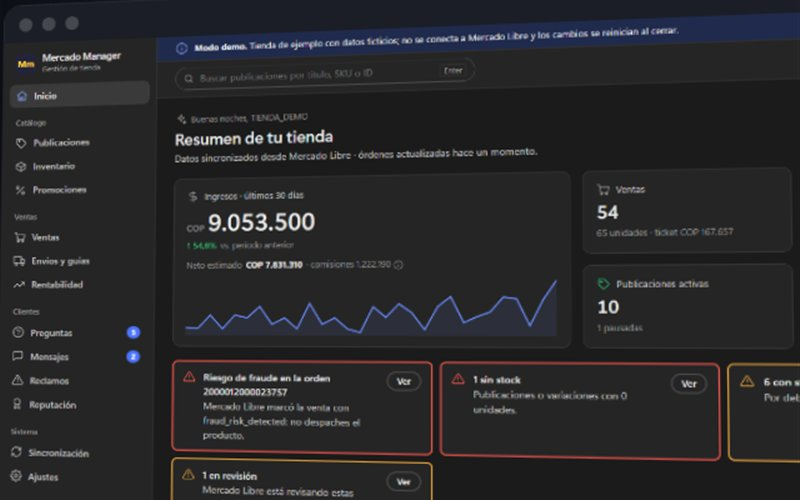
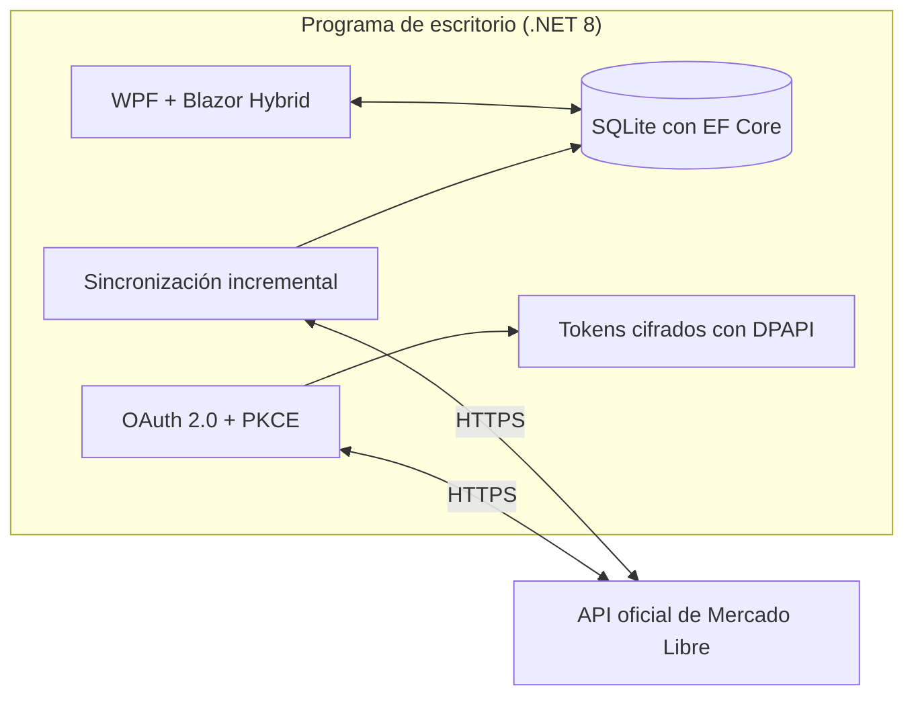

Administra una tienda de Mercado Libre desde el escritorio, 100 % local y con la API oficial: publicaciones, ventas, envíos y rentabilidad.

<a href="https://sotomontes.com/#mercado-manager"><b>Ver en sotomontes.com</b></a> · <a href="#cómo-se-usa">Cómo se usa</a> · <a href="#cómo-funciona-por-dentro">Cómo funciona</a> · <a href="#novedades">Novedades</a>

| Ficha técnica | |
|---|---|
| **Autor** | Sebastian Sotomontes |
| **Tipo** | Comercio |
| **Plataforma** | Windows 10 y 11 |
| **Versión** | 1.2.0 |
| **Estado** | Estable |
| **Stack** | C# · WPF · Blazor Hybrid · SQLite |
| **Código** | Privado. Esta página es solo una presentación. |

---

## Qué es

Mercado Manager administra una tienda de Mercado Libre desde el escritorio. Reúne en un solo lugar lo que normalmente exige saltar entre muchas pantallas: publicaciones, stock, ventas, envíos, preguntas y rentabilidad. Todo se guarda en tu equipo y se conecta con la API oficial, sin servidores de por medio.

## Novedades

- Interfaz rediseñada, preguntas y mensajes de posventa.
- Envíos y guías con impresión en mosaico.

## Cómo se usa

1. Abre el programa e inicia sesión con tu cuenta principal de Mercado Libre en la ventana oficial de autorización.
2. Espera la primera sincronización. **Inicio** muestra ingresos, ventas, lo que falta por despachar y las alertas importantes.
3. En **Publicaciones** e **Inventario** edita precios y stock, y crea publicaciones nuevas con el botón **Publicar**.
4. En **Ventas** y **Envíos y guías** revisa las órdenes e imprime las guías.
5. En **Preguntas**, **Mensajes** y **Reclamos** atiende a tus compradores.
6. En **Rentabilidad** y **Reputación** mide cómo va la tienda.

## Funciones

- **Catálogo**: publicaciones, inventario y promociones.
- **Ventas**: órdenes, envíos, guías y rentabilidad.
- **Clientes**: preguntas, mensajes, reclamos y reputación.
- **Alertas** de stock bajo, publicaciones en revisión y riesgo de fraude.
- **100 % local**: datos en SQLite y acceso con la API oficial y OAuth 2.0.

## Detalles

- Avisa de riesgo de fraude, productos sin stock y publicaciones en revisión.
- Sincronización periódica e incremental.
- Incluye un modo demo con una tienda de ejemplo.
- Tema claro y oscuro.

## Privacidad y seguridad

El acceso usa OAuth 2.0 oficial. Los tokens se guardan cifrados con la protección de Windows, los registros eliminan secretos y el programa no abre ningún puerto.

## Cómo funciona por dentro

### Arquitectura

### Todo local

No hay servidor, hosting ni servicios de terceros. La única conexión es con la API de Mercado Libre, y el programa no abre ningún puerto.

### Inicio de sesión

Usa OAuth 2.0 oficial con Authorization Code, PKCE y `state`, dentro de una ventana WebView2 que solo permite navegar por HTTPS. Los tokens se cifran con DPAPI y se renuevan automáticamente. Si se copia la base de datos a otro equipo, los tokens no se pueden leer allí.

### Por qué sincroniza en vez de recibir avisos

Mercado Libre envía sus notificaciones a una URL pública y exige respuesta en menos de 500 ms. Un programa local no tiene esa URL, así que la sincronización es periódica e incremental: recorre las publicaciones por última actualización hasta llegar a las que no cambiaron, y pide solo las órdenes modificadas. El intervalo se configura desde 5 minutos y hay un botón para sincronizar al momento.

### Resiliencia

Ante errores 429 o 5xx aplica reintentos con espera creciente y variación aleatoria. Los registros pasan por un redactor que elimina tokens y secretos.

### Límites conocidos de la API

- Las órdenes se conservan hasta 12 meses y la búsqueda como vendedor excluye las canceladas.
- Las guías solo aplican a Mercado Envíos 2 cuando están listas para imprimir.
- El neto descuenta la comisión de venta, pero no todos los costos.
- La búsqueda por título se hace sobre la copia local.

---

© 2026 Sebastian Sotomontes. Todos los derechos reservados.
