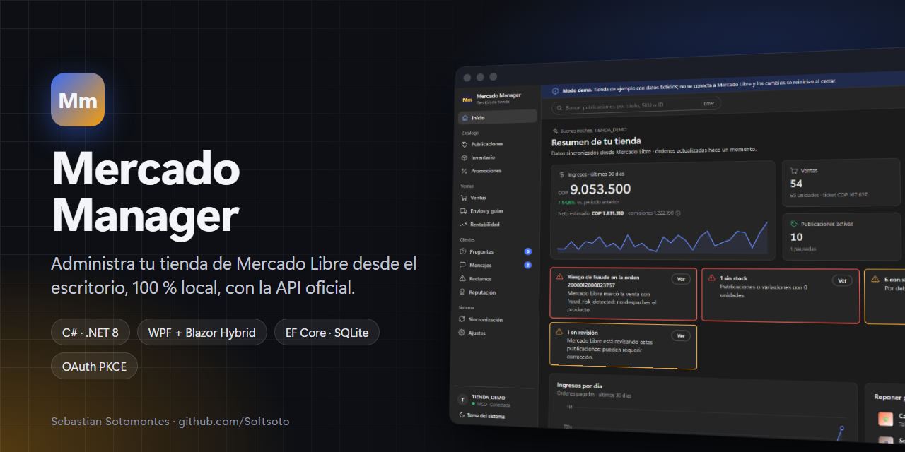

<h1 align="center">Mercado Manager</h1>

Administra una tienda de Mercado Libre desde el escritorio, 100 % local y con la API oficial: publicaciones, ventas, envíos y rentabilidad.

<a href="https://sotomontes.com/#mercado-manager"><b>Ver en sotomontes.com</b></a>

**Autor:** Sebastian Sotomontes · © 2026

> Esta página es solo una presentación del proyecto. El código y los instaladores son privados.

---

## Funciones

- **Catálogo**: publicaciones, inventario y promociones.
- **Ventas**: órdenes, envíos, guías y rentabilidad.
- **Clientes**: preguntas, mensajes, reclamos y reputación.
- **Alertas** de stock bajo, publicaciones en revisión y riesgo de fraude.
- **100 % local**: datos en SQLite y acceso con la API oficial y OAuth 2.0.

## Tecnologías

C# · WPF · Blazor Hybrid · SQLite

© 2026 Sebastian Sotomontes. Todos los derechos reservados.
